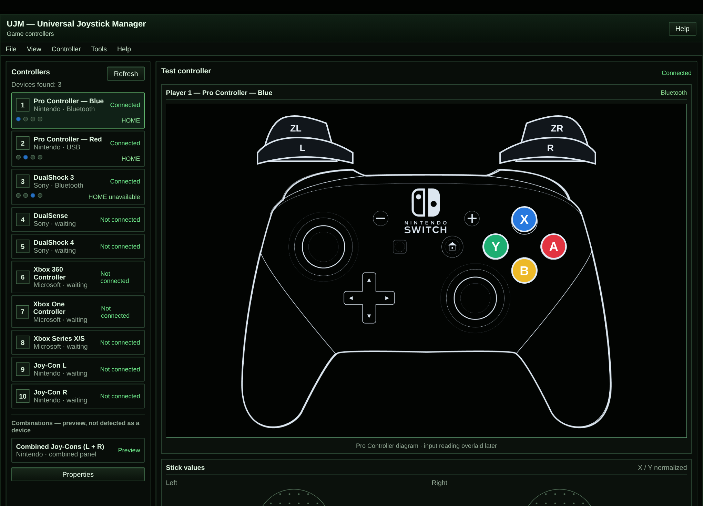
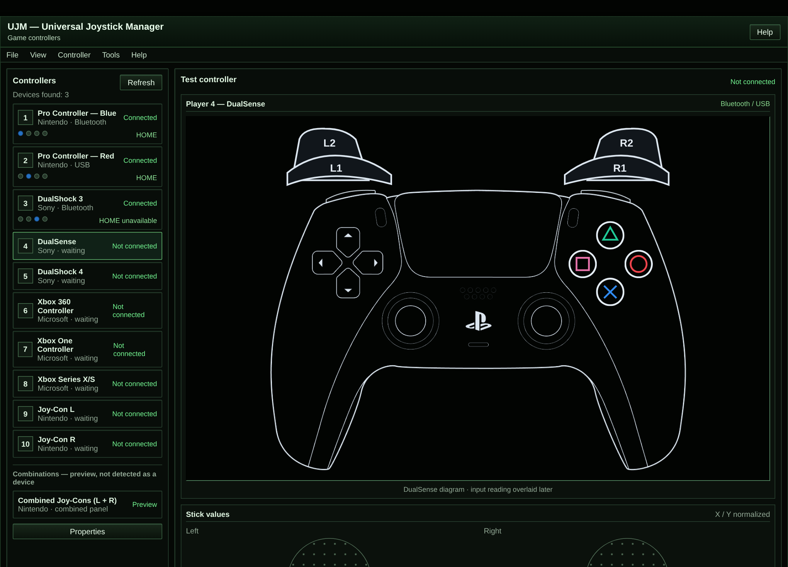
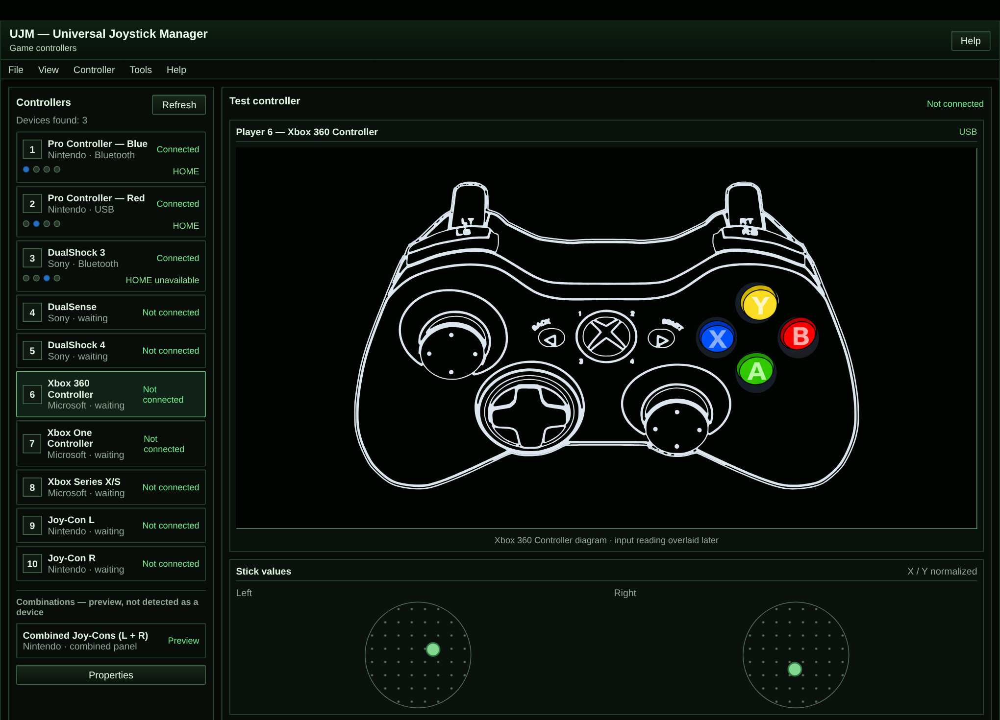
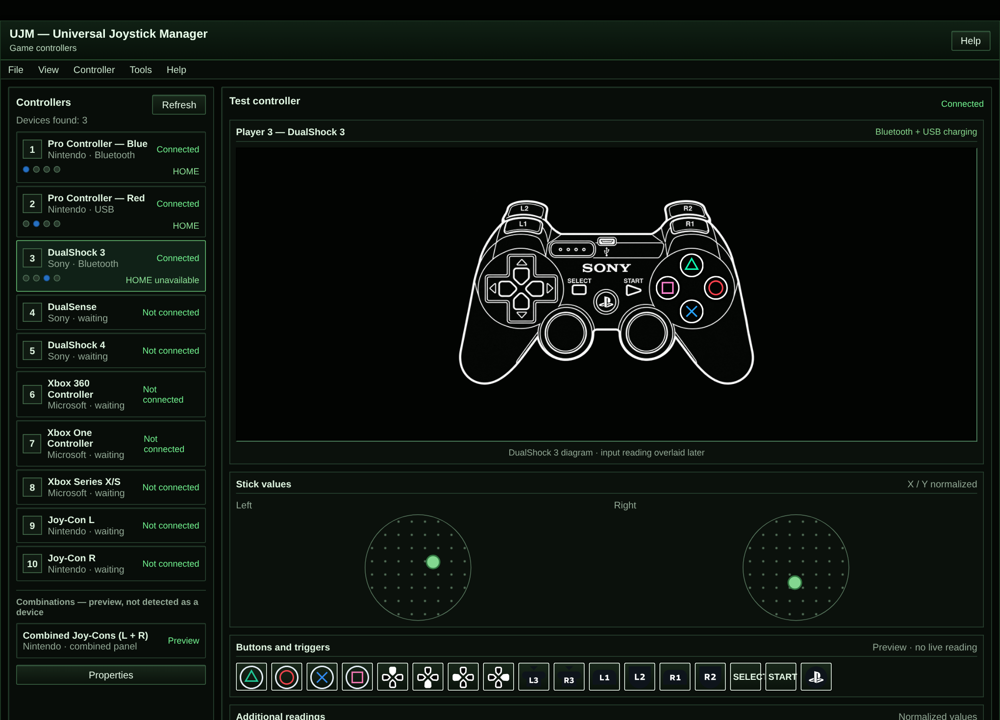
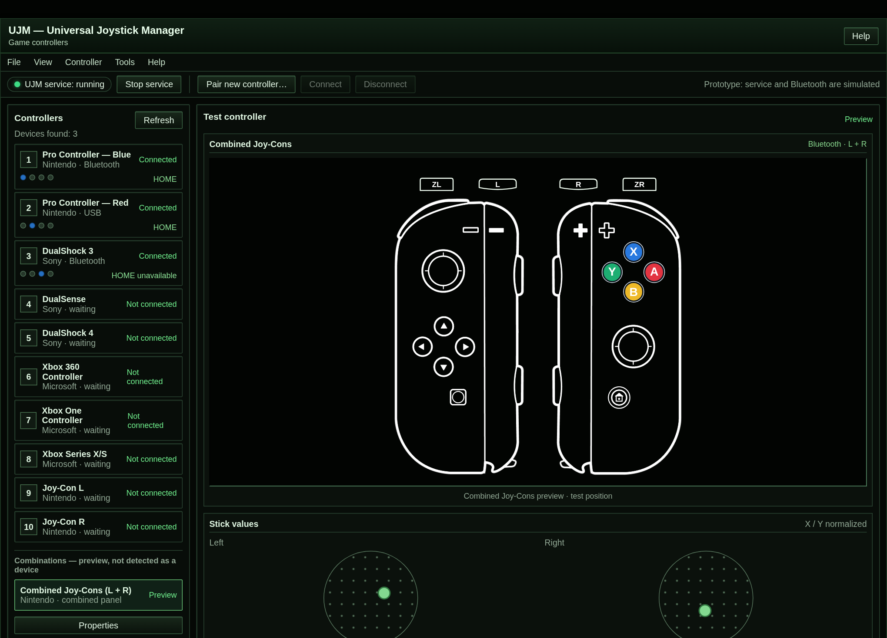
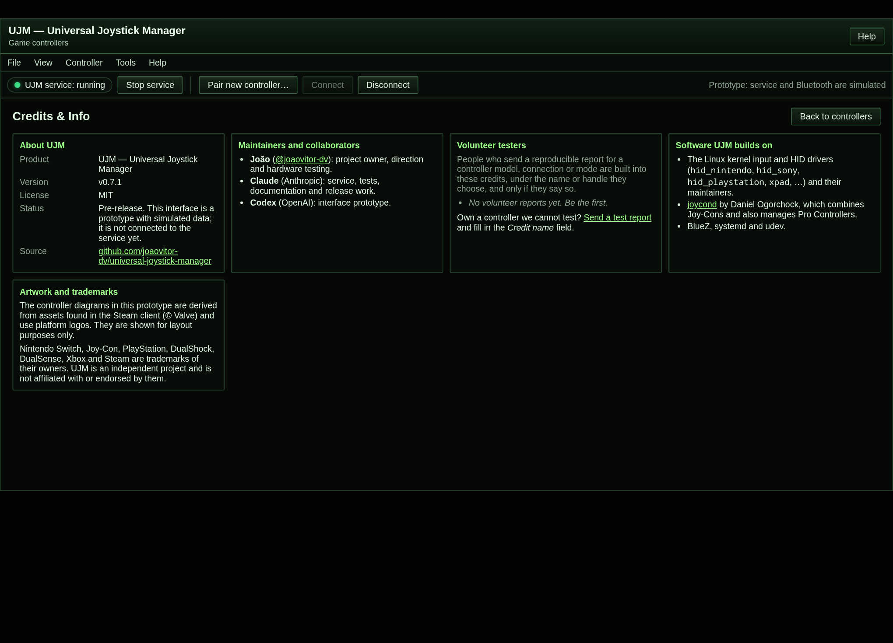
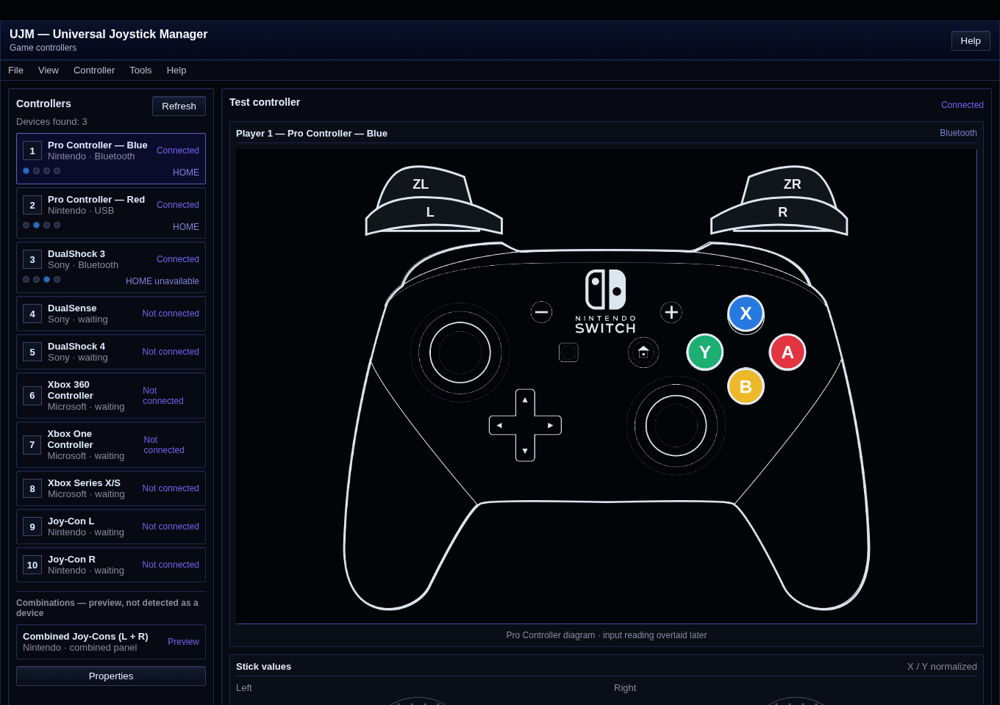
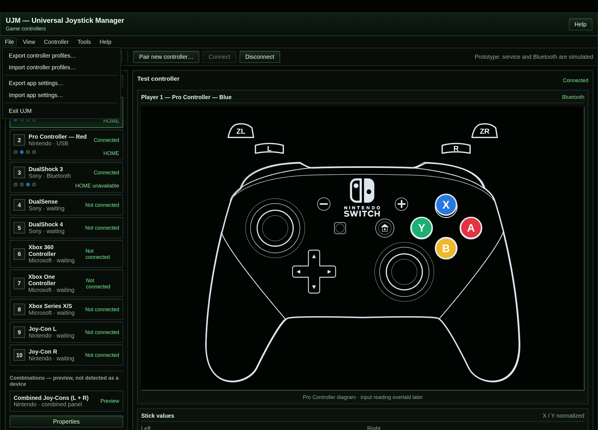
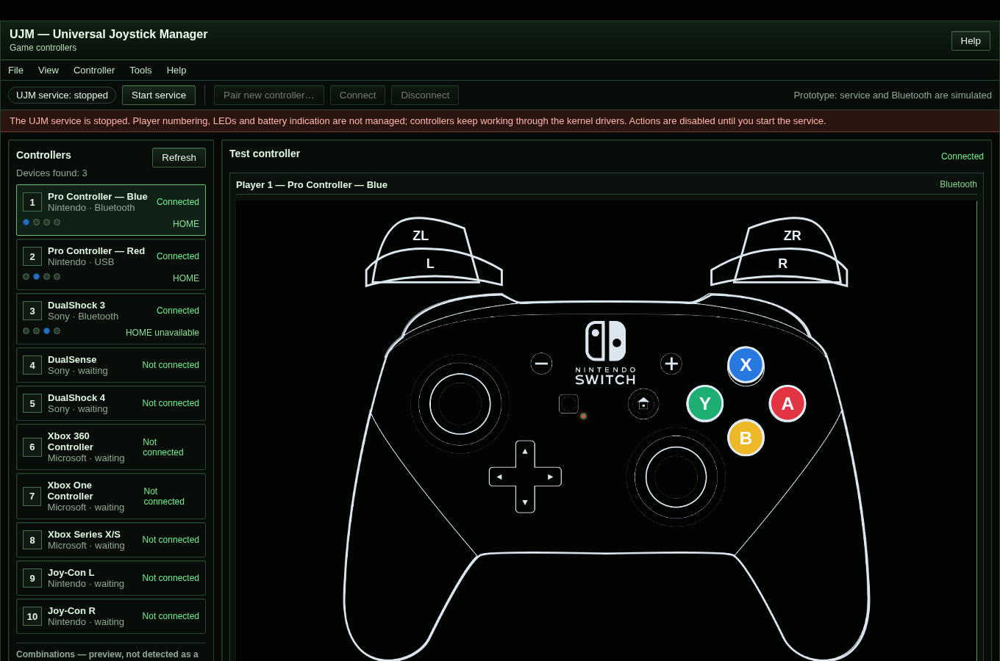

# UJM — Universal Joystick Manager v0.8.0

[](https://github.com/joaovitor-dv/universal-joystick-manager/actions/workflows/ci.yml)
[](LICENSE)
[](https://github.com/joaovitor-dv/universal-joystick-manager/releases)


**UJM numbers your game controllers consistently every time, keeps their LEDs and battery indicators honest, and handles the Bluetooth/USB quirks of each family, as one small Linux service.**

<p align="center">
  
</p>

> The picture above is the **interface prototype** with **simulated data**. It is not connected to the service yet; see [Roadmap](#roadmap). What works today is the command-line service described below.

**Contents:** [What it does](#what-it-does) · [Supported controllers](#supported-controllers) · [Install](#install) · [Using UJM](#using-ujm) · [Configuration](#configuration) · [Troubleshooting](#troubleshooting) · [The interface prototype](#the-interface-prototype) · [Roadmap](#roadmap) · [Help us test](#help-us-test) · [Patch notes](#patch-notes)

UJM is **pre-release software** (version 0.x). It was developed and tested on Arch Linux/CachyOS with a Realtek Bluetooth adapter. The story behind every change is in the [devlog](DEVLOG.md).

## What it does

| Core function | What you get |
|---|---|
| **Player numbering** | Controllers get player 1-8 **by connection order**, not by MAC address. A controller that reconnects takes the lowest free slot; one that switches from Bluetooth to USB keeps its slot. |
| **Player LEDs** | The player number is shown on the controller's LEDs. Players 5-8 use combinations of the four LEDs. |
| **Battery indication** | Where the driver exposes a battery, the player LED stays steady when the level is normal, blinks while charging, and pulses at low (25% or less) and critical (10% or less) levels. |
| **Idle power-off (Bluetooth)** | A Bluetooth controller with no input for 5 minutes (configurable) is disconnected to save its battery. |
| **`joycond` integration (optional)** | With the optional [`joycond`](https://github.com/DanielOgorchock/joycond), two Joy-Cons combined into one virtual device take one slot and keep their LEDs in sync. `joycond` also manages **Pro Controllers**: while it runs, each one waits for a logical pairing (blinking player LEDs) until you press L + R on it. |
| **Pro Controller on USB** | A Pro Controller plugged in by cable is recognized and numbered like any other. |
| **Reliable reconnection** | UJM keeps the Bluetooth adapter *connectable* (it needs `btmgmt`, from `bluez-utils` on Arch), so pressing HOME on a Pro Controller reconnects it. |
| **Controller profiles** | A table ([`controllers.tsv`](controllers.tsv)) says which families are recognized and which kernel driver to expect. Only validated families are active by default. |
| **Diagnostics** | `joystickmanager-doctor` shows which kernel modules are present and which connected controllers matched a profile, without changing anything. |

How slots map to LEDs (left Joy-Con, Pro Controller and DualShock 3 patterns; the right Joy-Con is mirrored):

| Player | 1 | 2 | 3 | 4 | 5 | 6 | 7 | 8 |
|---|---|---|---|---|---|---|---|---|
| LEDs lit | 1 | 2 | 3 | 4 | 1+4 | 2+4 | 3+4 | 1+3+4 |

## Supported controllers

**Validated** means it was tested on real hardware by the maintainers. Everything else is **expected to work from general Linux knowledge but is not validated**, and stays off until you set `JOYMANAGER_EXPERIMENTAL=1`.

| Family | State | Connection | Kernel driver |
|---|---|---|---|
| DualShock 3 (original) | validated | Bluetooth, USB | `hid_sony` |
| Switch Pro Controller (original) | validated | Bluetooth, USB | `hid_nintendo` |
| Joy-Con L/R (original and third-party) | validated | Bluetooth | `hid_nintendo` |
| Combined Joy-Cons via `joycond` | validated | virtual | `uinput` |
| Xbox 360 / One / Series (wired) | experimental | USB | `xpad` |
| Xbox One / Series over Bluetooth | experimental | Bluetooth | `hid_microsoft` (optional external: `xpadneo`) |
| DualShock 4, DualSense | experimental | Bluetooth, USB | `hid_playstation` |
| 8BitDo, GameSir, Logitech, Razer, Redragon, XInput clones | experimental | varies | `xpad`, `hid_generic`, ... depends on model and mode |
| Switch 2 Pro Controller / Joy-Con 2 | planned | - | no stable driver yet |

Hardware used for validation: 1 original DualShock 3, 2 original Switch Pro Controllers, 1 pair of original Joy-Cons, 1 pair of third-party Joy-Cons. A brand name alone never decides support: model, connection mode and driver all matter. Own one of the experimental controllers? [Help us test](#help-us-test).

## Install

**Requirements:** Linux with systemd, udev, D-Bus and BlueZ. Arch Linux/CachyOS is the primary target.

**Packages:** from the next release on, every release page has a `.deb` (Debian/Ubuntu), an `.rpm` (Fedora), an Arch package and a source tarball, with `SHA256SUMS`. An AUR package is prepared and will be published later. After installing a package, run `sudo systemctl enable --now joystickmanager`. Flatpak and AppImage are planned for the graphical interface only: they cannot install a system service. Details in [docs/packaging.md](docs/packaging.md).

**From source** (any systemd distribution):

```bash
git clone https://github.com/joaovitor-dv/universal-joystick-manager.git
cd universal-joystick-manager
# optional: pin to a release instead of main, for example
# git checkout v0.8.0
sudo ./install.sh
sudo systemctl start joystickmanager
```

`install.sh` installs the dependencies with your package manager (`bluez`, `upower`, `evtest`, `joystick`), copies the files below and **enables** the service (it starts at next boot; the last line above starts it now):

| File | Installed to |
|---|---|
| `joystickmanager.sh` | `/usr/local/bin/joystickmanager.sh` |
| `joystickmanager-doctor` | `/usr/local/bin/joystickmanager-doctor` |
| `controllers.tsv` | `/usr/local/share/joystickmanager/controllers.tsv` |
| `switchpro-leds.py` | `/usr/local/libexec/joystickmanager-switchpro-leds` |
| `joystickmanager.service` | `/etc/systemd/system/joystickmanager.service` |

**Optional components**

- **`joycond` (Joy-Con pairs, and it also affects Pro Controllers):** install [`joycond`](https://github.com/DanielOgorchock/joycond) yourself (on Arch, the AUR package `joycond-git`) and enable `joycond.service`. UJM does not install it for you. Be aware that `joycond` is not only for Joy-Cons: it manages **Pro Controllers too**. While it is running, a Pro Controller shows blinking player LEDs until you press **L + R** on it to complete the logical pairing; in our tests the LEDs only settled on the steady player number after that step. If you do not want that extra step, leave `joycond` disabled.
- **External drivers** such as `xone` and `xpadneo` are third-party code built through DKMS. UJM does not install or package them.
- **Charge the Pro Controller without losing Bluetooth:** `sudo ./install.sh --pro-charge-only` adds a udev rule. Read [the caveats](#the-pro-controller-and-usb-cables) first.
- **D-Bus bridge for the graphical interface (in development):** `sudo ./install.sh --with-bridge`. Nothing uses it yet, so you only need it when you try the interface. It starts when something calls it and stops by itself. See [docs/bridge.md](docs/bridge.md).

**Check that it works**

```bash
systemctl status joystickmanager
cat /run/joystickmanager/slots.tsv      # one line per connected controller
joystickmanager-doctor                  # drivers and profile matches
```

`slots.tsv` columns: controller id (Bluetooth address), player slot, HID device, input event. A fuller, machine-readable snapshot is in `/run/joystickmanager/state.json` (see [docs/state.md](docs/state.md)).

**Uninstall**

```bash
sudo systemctl disable --now joystickmanager
sudo rm /usr/local/bin/joystickmanager.sh /usr/local/bin/joystickmanager-doctor \
        /usr/local/libexec/joystickmanager-switchpro-leds \
        /etc/systemd/system/joystickmanager.service
sudo rm -r /usr/local/share/joystickmanager
sudo rm -f /etc/udev/rules.d/99-joystickmanager-procontroller-charge-only.rules
sudo systemctl daemon-reload
```

## Using UJM

There is nothing to launch: the service runs in the background and acts when a controller appears.

**Connect a Bluetooth controller.** Pair it once with BlueZ, then it reconnects by itself:

```bash
bluetoothctl
> scan on
# put the controller in pairing mode (Switch controllers: hold the sync button)
> pair AA:BB:CC:DD:EE:FF
> trust AA:BB:CC:DD:EE:FF
> connect AA:BB:CC:DD:EE:FF
```

Next time, press **HOME** (Switch controllers) or the PS button (DualShock 3) to reconnect it.

**Watch the numbering.** Connect two controllers and look at their LEDs, or read the table:

```bash
cat /run/joystickmanager/slots.tsv
```

**Pair with `joycond` (Joy-Cons and Pro Controllers).** While `joycond` waits for a logical pairing the player LEDs may blink. Press **L + R** together on each Pro Controller to complete it. For a virtual device made of two Joy-Cons, press **+ and -**.

**Check a controller that is not detected.** Run `joystickmanager-doctor`: it lists, per family, whether each kernel module is loaded, available or absent, and which connected controllers matched a profile.

### The Pro Controller and USB cables

A Switch Pro Controller plugged into the computer with a **data** cable switches from Bluetooth to USB, and the firmware drops the Bluetooth connection. UJM recognizes it on USB and keeps its player number, but it cannot stop the switch on its own. Your options:

1. **Use a charge-only cable**, an adapter without data lines, or a charger that does not expose USB to the computer. This always works.
2. **Deauthorize the USB device by hand**: `echo 0 | sudo tee /sys/bus/usb/devices/<port>/authorized`. On hardware this kept the controller on Bluetooth with the battery reporting `Charging`. The setting is lost every time the cable is replugged.
3. **Install the optional udev rule** (`sudo ./install.sh --pro-charge-only`) that does the same automatically. **It has not been tested on hardware yet**, the controller stops working wired while it is installed, and it may still drop Bluetooth for a moment when you plug in.

## Configuration

All settings are environment variables of the service. To change one, run `sudo systemctl edit joystickmanager` and add, for example:

```ini
[Service]
Environment=JOYMANAGER_IDLE_TIMEOUT=600
```

then `sudo systemctl restart joystickmanager`.

| Variable | Default | What it does |
|---|---|---|
| `JOYMANAGER_IDLE_TIMEOUT` | `300` | Seconds of inactivity before a Bluetooth controller is disconnected; `0` turns it off. It was 1800 during the testing phase, until the numbering, Joy-Con and battery tests passed. |
| `JOYMANAGER_LED_SETTLE` | `6` | Seconds a Nintendo controller (Pro Controller, Joy-Con) is left alone after connecting before its LEDs are written: its firmware finishes initialising by then and overwrites anything sent earlier. `0` writes at once. |
| `JOYMANAGER_HOME_REFRESH` | `10` | Seconds between re-sends of the HOME LED (Pro Controller, Joy-Con R). The controller keeps that light on for only about 15 s after each command, so it is re-sent on its own cadence, one command per controller; the player LEDs are not rewritten. `0` never re-sends it (the light then goes dark on its own). |
| `JOYMANAGER_LED_REFRESH` | `10` | Seconds between LED re-applications. `off` applies the LEDs once per connected controller and never again (experimental: under test on hardware, see the devlog). `0` re-applies on every 2 s cycle (the old behavior). Any other value falls back to `10`. Real changes, such as starting to charge, are always written at once. |
| `JOYMANAGER_EXPERIMENTAL` | `0` | `1` enables `experimental` and `planned` controller profiles. |
| `JOYMANAGER_PROFILES` | auto | Path to a custom profile table. If the file is missing, the service uses its built-in list of validated controllers. |
| `JOYMANAGER_RUNTIME_DIR` | `/run/joystickmanager` | Where `slots.tsv` lives. |

## Troubleshooting

| Symptom | What to check |
|---|---|
| **Pressing HOME does not reconnect a Pro Controller** | Run `sudo btmgmt info \| grep "current settings"`. It should include `connectable`; UJM re-asserts it about every 20 s. If it is missing, check `systemctl status joystickmanager`. |
| **My controller is not listed in `slots.tsv`** | Run `joystickmanager-doctor`. If its family is `experimental`, set `JOYMANAGER_EXPERIMENTAL=1`. If no profile matches, [open a test report](https://github.com/joaovitor-dv/universal-joystick-manager/issues/new/choose). |
| **The controller drops Bluetooth when I plug in a cable** | Expected for data cables, see [above](#the-pro-controller-and-usb-cables). |
| **The Pro Controller disconnects every few minutes; `journalctl -k` shows `exceeded max attempts` or `timeout waiting for input report`** | Make sure you run v0.6.1 or newer; older versions rewrote the LEDs too often. |
| **LEDs show the wrong pattern for a few seconds** | A Nintendo controller finishes initialising a few seconds after connecting and rewrites its own LEDs (and turns the HOME LED off), so UJM waits `JOYMANAGER_LED_SETTLE` seconds (6) before the first write; after that the firmware can still restore its pattern, and UJM fixes it at the next refresh (10 s by default; with `LED_REFRESH=off` it does not). The HOME LED goes dark by itself about 15 s after each command, so UJM re-sends it every `JOYMANAGER_HOME_REFRESH` seconds (10). Lower `JOYMANAGER_LED_REFRESH` if it bothers you, but very low values can overload the controller. |
| **Player LEDs keep blinking (Joy-Cons or Pro Controllers)** | `joycond` is waiting for a logical pairing: press **L + R** (Pro Controller) or **+ and -** (combined Joy-Cons). |
| **I need logs** | `journalctl -u joystickmanager`, `journalctl -k \| grep -i nintendo`, `journalctl -u bluetooth`. |

## The interface prototype

A graphical interface is being designed. Today it is a static HTML **prototype with simulated data**, used to settle the layout before the service exposes an API. It is in [`ui/`](ui/README.md) and is not connected to the daemon yet. Open `ui/index.html` in a browser (or serve the folder with `python3 -m http.server --directory ui 8000`). The controller artwork in `ui/assets/` is third-party and **not covered by the MIT license**: see [`ui/assets/ASSETS-NOTICE.md`](ui/assets/ASSETS-NOTICE.md).

| | |
|---|---|
|  |  |
|  |  |
|  |  |
|  |  |

What the prototype already explores: a list of controllers with player number, transport and LEDs; a per-controller diagram with the real button names of each family; stick values; a **Combined Joy-Cons** entry in the list (it is just another controller, not a separate tab); a **File** menu (export and import **controller profiles** and **app settings** as JSON files, and **Exit UJM**); a toolbar with a **Start/Stop service** button and Bluetooth shortcuts (**Pair new controller…**, **Connect**, **Disconnect**); **Help → Credits & Info** (version, collaborators, the volunteer testers from [`CREDITS.md`](CREDITS.md), third-party software and trademarks); and **View → Theme…**, where you pick your own background, accent and text colors or a preset. The theme is **dark only, on purpose**: the interface has no light mode, and anyone who tries to force one gets teased for it. Semantic colors such as the A/B/X/Y buttons are never recolored. The service button and the Bluetooth shortcuts are **simulated** in the prototype: with the service stopped the interface shows a banner and disables the actions, because the real application will be read-only whenever the service is not running.

## Roadmap

Nothing below is promised for a date. The order follows the current priorities.

**Next (stabilizing 0.x)**
- A long soak test with a Pro Controller and a Joy-Con R connected together, to confirm the LED throttling from v0.6.1 and check the idle power-off on USB controllers.
- Mapping the dedicated blue HOME LED of the right Joy-Con and how it interacts with `joycond`, `hid-nintendo` and the HID helper.
- Testing the optional charge-only udev rule on hardware.
- Building and testing the Debian/Ubuntu and Fedora packages.

**Interface**
1. Define the daemon's state model and events.
2. A read-only local API (D-Bus is the first candidate), so a client can list controllers, battery, LEDs and slots without touching `/sys` or BlueZ.
3. A Qt/QML application for KDE: overview cards (name, vendor, player, transport, battery, LEDs, time to power-off), a details view (edit name, test LEDs, reconnect, change the timeout) and an optional **input monitor** (buttons, sticks, triggers, accelerometer and gyroscope), with the daemon doing all privileged access.
4. Persistent settings and aliases stored by stable address, then actions (connect, LEDs, `joycond`) and an optional autostart.

**More controllers**
- Validate the experimental families (Xbox, DualShock 4, DualSense, 8BitDo, GameSir, Logitech, Razer, Redragon) with volunteers and promote them to `validated` after a reproducible test. Each model and connection mode (XInput, DInput, Switch, Bluetooth, USB, receiver) is validated separately.
- Switch 2 Pro Controller and Joy-Con 2, once a stable driver exists.
- Integration with Steam Input without duplicated devices.

**Longer term**
- **A console-only edition (maybe).** The brand is UJM but the technical identifiers stay `joystickmanager.service`, `JOYMANAGER_*` and `/run/joystickmanager`: renaming them on their own would break existing installs for no gain, so it is not planned. It would only make sense together with a **console-only edition** installed as plain `ujm`, with a `ujm` command and a `ujm` service id. That edition is an idea, not a commitment, and it would ship with a migration path.
- **Windows 10/11** as a future extension: the GUI and data model can be shared, but discovery, Bluetooth, battery and LEDs need a separate Windows backend. It is not a promise of parity with Linux.
- **1.0.0** when the validated hardware matrix above is complete.

## Help us test

Most controllers are not available to the maintainers. If you own one, the [volunteer testing guide](docs/volunteer-testing.md) explains what to collect safely, and you can [open a test report](https://github.com/joaovitor-dv/universal-joystick-manager/issues/new/choose).

**Testers are part of the project.** Everyone who sends a reproducible report is built into the [credits](CREDITS.md) and into the app's **Credits & Info** page (Help menu), under the name or handle they choose. Say so in the *Credit name* field of the report; nothing is listed without your consent. Other docs: [credits](CREDITS.md), [architecture](docs/architecture.md), [dependencies and drivers](docs/dependencies.md), [devlog](DEVLOG.md), [contributing](CONTRIBUTING.md), [security policy](SECURITY.md).

## Patch notes

Newest first. Each version links to its release page; the reasoning and hardware evidence are in the [devlog](DEVLOG.md).

| Version | Date | Highlights |
|---|---|---|
| [v0.8.0](https://github.com/joaovitor-dv/universal-joystick-manager/releases/tag/v0.8.0) | 2026-10-16 | The interface joins the repository: `ui/` prototype with browser tests, credits, dark-only themes, File menu and simulated service and Bluetooth |
| [v0.7.1](https://github.com/joaovitor-dv/universal-joystick-manager/releases/tag/v0.7.1) | 2026-10-16 | English docs and the UJM name |
| [v0.7.0](https://github.com/joaovitor-dv/universal-joystick-manager/releases/tag/v0.7.0) | 2026-10-16 | Opt-in udev rule to charge the Pro Controller without losing Bluetooth |
| [v0.6.1](https://github.com/joaovitor-dv/universal-joystick-manager/releases/tag/v0.6.1) | 2026-10-16 | Gentler LED updates: fixes Pro Controller drops |
| [v0.6.0](https://github.com/joaovitor-dv/universal-joystick-manager/releases/tag/v0.6.0) | 2026-10-16 | `joystickmanager-doctor` and wider packaging |
| [v0.5.0](https://github.com/joaovitor-dv/universal-joystick-manager/releases/tag/v0.5.0) | 2026-10-16 | Controller profiles (`controllers.tsv`) |
| [v0.4.2](https://github.com/joaovitor-dv/universal-joystick-manager/releases/tag/v0.4.2) | 2026-10-16 | Bluetooth adapter stays connectable: HOME reconnects the Pro Controller |
| [v0.4.1](https://github.com/joaovitor-dv/universal-joystick-manager/releases/tag/v0.4.1) | 2026-10-16 | Pro Controller recognized over USB |
| [v0.4.0](https://github.com/joaovitor-dv/universal-joystick-manager/releases/tag/v0.4.0) | 2026-10-16 | Players numbered by connection order, first test suite |
| [v0.3.5](https://github.com/joaovitor-dv/universal-joystick-manager/releases/tag/v0.3.5) | 2026-10-15 | Right Joy-Con LED order fixed |
| [v0.3.4](https://github.com/joaovitor-dv/universal-joystick-manager/releases/tag/v0.3.4) | 2026-10-15 | Idle power-off configurable, default 30 minutes |
| [v0.3.3](https://github.com/joaovitor-dv/universal-joystick-manager/releases/tag/v0.3.3) | 2026-10-15 | Pro Controller LEDs addressed by Bluetooth address |
| [v0.3.2](https://github.com/joaovitor-dv/universal-joystick-manager/releases/tag/v0.3.2) | 2026-10-15 | Pro Controller LEDs use the right HID interface |
| [v0.3.1](https://github.com/joaovitor-dv/universal-joystick-manager/releases/tag/v0.3.1) | 2026-10-15 | Pro Controller LEDs: output report sequence |
| [v0.3.0](https://github.com/joaovitor-dv/universal-joystick-manager/releases/tag/v0.3.0) | 2026-10-15 | Pro Controller player LEDs via HID |
| [v0.2.1](https://github.com/joaovitor-dv/universal-joystick-manager/releases/tag/v0.2.1) | 2026-10-15 | Faster LED re-apply |
| [v0.2.0](https://github.com/joaovitor-dv/universal-joystick-manager/releases/tag/v0.2.0) | 2026-10-15 | HOME LED as a connection indicator |
| [v0.1.3](https://github.com/joaovitor-dv/universal-joystick-manager/releases/tag/v0.1.3) | 2026-10-15 | Battery status on the player LED |
| [v0.1.2](https://github.com/joaovitor-dv/universal-joystick-manager/releases/tag/v0.1.2) | 2026-10-15 | Player LEDs re-applied before battery state |
| [v0.1.1](https://github.com/joaovitor-dv/universal-joystick-manager/releases/tag/v0.1.1) | 2026-10-15 | Connection LED stays on outside battery alerts |
| [v0.1.0](https://github.com/joaovitor-dv/universal-joystick-manager/releases/tag/v0.1.0) | 2026-10-15 | `joycond` integration, installers and packages |
| [v0.0.2](https://github.com/joaovitor-dv/universal-joystick-manager/releases/tag/v0.0.2) | 2026-10-15 | Eight players |
| [v0.0.1](https://github.com/joaovitor-dv/universal-joystick-manager/releases/tag/v0.0.1) | 2026-10-15 | Bootstrap |

## License

MIT for the code. See [LICENSE](LICENSE). The controller artwork in `ui/assets/` is third-party and is not covered by the MIT license; see [`ui/assets/ASSETS-NOTICE.md`](ui/assets/ASSETS-NOTICE.md).
